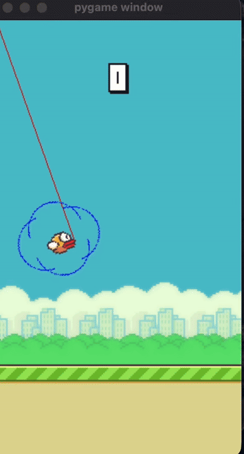

# 🐦 Deep Q-Network (DQN) Flappy Bird Agent

An implementation of a **Deep Q-Network (DQN)** reinforcement learning agent built from scratch using **PyTorch** and **Gymnasium** to play and master *Flappy Bird*.

---

## 🎥 Demo



---

## 🧠 Architecture & Methodology

This project utilizes **Deep Q-Learning** enhanced with **Experience Replay** and a **Target Network** to stabilize training:

* **State Space (`state_dim=12`):** Low-dimensional LIDAR/sensor observations provided by `FlappyBird-v0`, representing distances to upcoming pipes and vertical positioning.
* **Action Space (`action_dim=2`):** Binary discrete control (`0` = Do nothing / Fall, `1` = Flap).
* **Policy & Target Networks (`dqn.py`):** A feedforward neural network built with PyTorch featuring a 256-unit hidden layer with ReLU activation. The target network periodically syncs weights from the policy network (`network_sync_rate`) to prevent moving-target instability.
* **Experience Replay (`experience_replay.py`):** A fixed-size FIFO replay buffer (`maxlen=100,000`) that stores transitions `(state, action, next_state, reward, done)` and samples random mini-batches during optimization to break temporal correlation.
* **Epsilon-Greedy Exploration:** Gradually decays exploration from `1.0` down to `0.05` (`epsilon_decay=0.9995`), balancing early environment discovery with late-stage policy exploitation.

---

## 📂 Project Structure

```text
├── runs/
│   ├── flappybirdv0.pt         # Saved weights of the highest-scoring model
│   └── flappybirdv0.log        # Training log tracking peak rewards
├── agent.py                    # Main training and evaluation loop
├── dqn.py                      # PyTorch DQN model definition
├── experience_replay.py        # Replay memory buffer implementation
├── game_fluppy_bird.py         # Manual playable version using Pygame
├── parameters.yaml             # Hyperparameter configurations
├── requirements.txt            # Python dependencies
├── demo.gif                    # Gameplay demonstration GIF
└── README.md                   # Project documentation
```

---

## ⚙️ Hyperparameters (`parameters.yaml`)

```yaml
flappybirdv0:
  env_id: FlappyBird-v0
  epsilon_init: 1
  epsilon_min: 0.05
  epsilon_decay: 0.9995
  replay_memory_size: 100000
  mini_batch_size: 32
  network_sync_rate: 10
  alpha: 0.001
  gamma: 0.99
  reward_threshold: 1000
```

---

## 🚀 Getting Started

### 1. Clone the Repository
```bash
git clone https://github.com/YOUR_USERNAME/YOUR_REPO_NAME.git
cd YOUR_REPO_NAME
```

### 2. Install Dependencies
```bash
pip install -r requirements.txt
```

### 3. Watch the Best Trained Model Play
Run the evaluation mode to load the saved weights (`runs/flappybirdv0.pt`) and render the agent playing live:
```bash
python agent.py flappybirdv0
```

### 4. Train Your Own Agent
To train the model from scratch (automatically detects CUDA, Apple MPS, or CPU):
```bash
python agent.py flappybirdv0 --train
```

### 5. Play Manually (Optional)
Test the environment yourself using the Spacebar to flap:
```bash
python game_fluppy_bird.py
```

---

## 🛠️ Tech Stack
* **Python 3**
* **PyTorch** (Neural network & automatic hardware acceleration via CUDA/MPS/CPU)
* **Gymnasium & Flappy Bird Gymnasium** (RL simulation environment)
* **Pygame** (Game rendering & manual controls)
* **PyYAML** (Configuration management)
